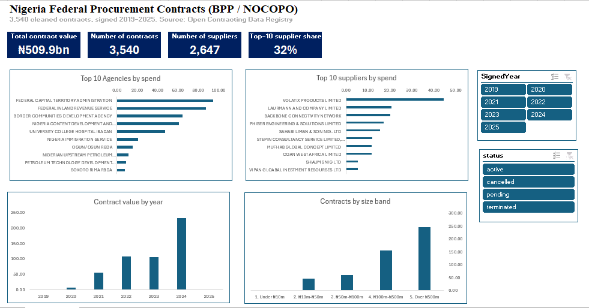
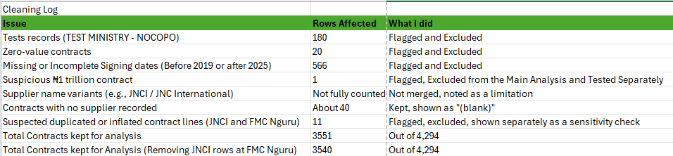

# Nigeria Federal Procurement Analysis (BPP / NOCOPO)

An Excel analysis of 3,540 federal government contracts, showing where the money goes, how concentrated it is among suppliers, and which data quality problems can distort the picture.

## Problem

Public procurement is one of the largest areas of government spending, and it is a common source of waste and risk. I wanted to answer six practical questions from real Nigerian data:

1. Which agencies spend the most?
2. How concentrated is spending among suppliers?
3. How are contract values distributed?
4. Which procurement methods are used, and how much money goes through each?
5. How many contracts fail, and how large are they?
6. How has contract value changed over time?

## Data

- **Source:** Bureau of Public Procurement (BPP), Nigeria Open Contracting Portal (NOCOPO), accessed through the Open Contracting Data Registry. 2025 extract.
- **Size:** 4,294 contracts across 12 linked sheets (contracts, awards, suppliers, payments, buyer records and others).
- **Used:** four sheets: `contracts`, `awards_suppliers`, `main` (buyer and procurement method) and a joining key between them.
- **Raw file:** kept unedited. All work was done on a copy.

## Tools

Excel (Power Query, PivotTables, PivotCharts, slicers). No code was needed.

## Process

1. **Combined the data.** Used Power Query to merge contracts, suppliers and buyer records into one table, matching on the IDs that link them.
2. **Standardised.** Trimmed and capitalised supplier names, converted text dates to real dates, and created year and contract-size columns.
3. **Cleaned by flagging, not deleting.** Each problem got its own flag column (1 = problem), so every decision is visible and reversible.
4. **Analysed** with PivotTables, filtered to the cleaned data.
5. **Built a dashboard** with KPI cards, four charts and slicers for year and contract status.

### Cleaning log

| Issue | Rows flagged | Action |
|---|---|---|
| Test records (buyer "TEST MINISTRY - NOCOPO") | 180 | Excluded |
| Zero-value contracts | 20 | Excluded |
| Missing or impossible signing dates (before 2019 or after 2025) | 566 | Excluded |
| One contract of about ₦1 trillion, far above all others | 1 | Excluded as a probable entry error |
| Suspected duplicated or inflated lines (one supplier, one hospital, 18 lines for the same job, 11 of them exactly 100x the value of the others) | 11 | Excluded; reported as a sensitivity check |
| Supplier name variants (e.g. "JNCI" / "JNC International") | not counted | Not merged; noted as a limitation |
| Contracts with no supplier recorded | about 40 | Kept |
| **Contracts kept for analysis** | **3,540 of 4,294** | |

Some rows trigger more than one flag, so the individual counts add up to more than the number removed.

## Key findings

**Cleaned dataset: 3,540 contracts, ₦509.9bn, 2,647 suppliers.**

1. **A few large contracts carry most of the money.** The 66 contracts above ₦500m (1.9% of contracts) hold 48% of all value. The 737 contracts above ₦100m are 21% of contracts but 79% of value. The 525 contracts under ₦10m add up to under 1%.
2. **Most contracts use open competition, but direct awards are larger than average.** National Competitive Bidding covers 56% of contracts and 64% of value. Direct Procurement is 10.5% of contracts but 15.3% of value (₦78.0bn). Direct, emergency and sole-source awards together come to about ₦79.8bn, or 15.7% of value.
3. **Terminated contracts are rare but large.** 38 contracts (1.1%) were terminated, worth ₦22.2bn (4.4% of value). The average terminated contract is about ₦584m, roughly four times the overall average of ₦144m.
4. **Spending more than doubled in 2024.** Value rose from ₦105bn (2023) to ₦232bn (2024) while the number of contracts barely moved (866 to 893), so the average contract roughly doubled, from ₦122m to ₦259m. These are nominal naira values, so inflation and the naira's depreciation explain part of the rise.
5. **One data issue changes the supplier picture.** With the suspect lines removed, the 10 largest suppliers hold about 32% of value and the largest holds 8.7%. With them included, the top 10 hold 44.5% and one supplier holds 19%.

## Recommendations

These are suggestions from the analysis, not conclusions about wrongdoing.

- **Review the largest contracts first.** About 740 contracts above ₦100m hold most of the value, so oversight effort goes furthest there.
- **Track direct procurement separately.** Because direct awards skip open competition and run larger than average, they deserve a regular check that each one is justified.
- **Add validation at data entry.** Checks for repeated records and values that are 10x or 100x others on the same job would catch problems like the one found here.
- **Report values in real terms.** Adjusting for inflation would show whether the 2024 jump reflects larger projects or higher prices.

## Limitations

- The suspected duplicate lines may have an explanation I cannot see in the data. I treated them as a data quality issue, not as proof of anything.
- Supplier names are not fully standardised, so some suppliers are likely split across spellings and their totals understated.
- Values are in nominal naira and are not adjusted for inflation.
- The data shows awarded contracts, not delivery or completion, so it cannot measure late delivery or actual spending.
- 2019, 2020 and 2025 have few records, which reflects portal coverage and when the data was extracted, not real drops in spending.
- Procurement method is missing for 32 contracts, and the KPI cards show the full cleaned dataset while the charts respond to the slicers.

## Files

- `Nigeria_Procurement_Analysis.xlsx`: the full workbook (dashboard, findings, cleaning log, pivots and the merged table)
- `dashboard.png`, `cleaning_log.png`: screenshots

## About

Built by Cecilia Daramola as part of a data analytics portfolio. Economics graduate (University of Ibadan), with a background in accounting and procurement.
